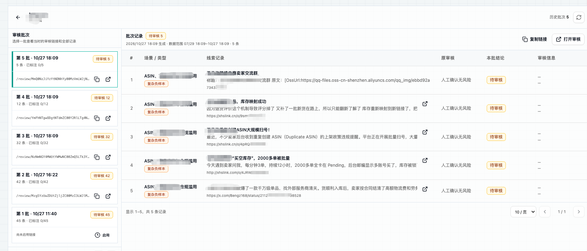

# AI Agent 工程化（二）：从测评构建到持续评估（上）

上一篇主要介绍了项目初期遇到的一些传统后端架构问题，以及我们如何通过改造提升平台的可用性。但系统稳定运行只是第一步。真正投入使用后，我们很快发现了另一个问题：**Agent 能够稳定地产出结果，并不意味着结果一定正确，也不一定符合预期。随着使用深入，我们陆续收集到不少误判、漏判和输出质量不理想的案例。**这些问题让我意识到，不能只依赖人工抽查和线上反馈来判断 Agent 是否变好了，**还需要把真实问题沉淀成一套可以重复运行、持续维护的测评集。**

# 为什么需要建立评测体系

在介绍测评集之前，先简单交代一下项目背景：旧审核平台主要依赖关键词规则。命中产品词、风险词等关键词的线索，会统一进入人工审核队列。规则可以快速筛出“可能存在风险”的内容，却很难结合上下文判断风险是否真实，也无法准确区分具体场景。**结果是，大量需要人工确认的线索混在一起，一线运营人员大约 80% 的时间都花在了审核上，只有约 20% 的时间用于后续跟进和事件生成。**

这个项目最初的目标，就是减少重复性的人工审核，让运营人员把更多时间投入到真正需要判断和推进的工作中。随着工单推进和反馈不断积累，我们发现，**Agent 的问题并不只在于“能不能识别风险”，还包括“是否识别完整”和“场景分类是否正确”。**目前收集到的问题主要包括：**部分风险线索被漏掉、线索被识别为风险，但被归入了错误的场景、不同风险场景之间存在分类冲突。**

例如，刷单相关线索被错误归类到物流诈骗场景，或者“助力活动”被误判为刷单。这些案例虽然看起来只是单条判断错误，但会直接影响一线运营人员对系统的信任和使用体验。


这时，问题就从“如何让 Agent 跑起来”，变成了：**如何建立一套统一、可量化的评估标准，并让风险研判的准确率稳定提升到 70%、80%，甚至更高？**仅依赖人工抽查和线上反馈，很难持续回答这个问题。**我们需要把真实项目中收集到的错误案例沉淀成测评集，定期运行和比较不同版本的结果，再根据测评结果持续调整 Prompt、工作流和 Agent 架构。**

本文分为上下两篇。上篇主要介绍评测对象、业务指标，以及如何从真实风险事件、生产 Trace 和人工审核反馈中构建评测集；下篇将继续介绍 Prompt、Context、RAG 和完整 Agent 链路的离线回归、在线评估、Experiment 与发布门禁。

# Agent 评测体系

在开始搭建测评集之前，需要先明确一件事：我们究竟在评测什么？

|层级|评测对象|主要回答的问题|常见指标|
|---|---|---|---|
|模型评测|基础模型或模型服务|这个模型本身具备什么能力？|MMLU、HumanEval、HELM、Pass@1、Elo|
|Agent 评测|模型、Prompt、工具、编排、记忆等整体系统|Agent 能否正确、稳定地完成业务任务？|任务成功率、分类准确率、轨迹、工具调用、状态变化、成本和延迟|
|产品评测|产品、用户和业务流程|这个 Agent 是否真正产生了业务价值？|审核耗时、误报率、漏报率、事件转化率、用户满意度、留存等|

这三层评测并不是相互替代的关系，而是在回答不同的问题：

- **模型评测关注模型本身的通用能力；**

- **Agent 评测关注模型经过 Prompt、工具和工作流编排后，能否完成具体任务；**

- **产品评测关注 Agent 上线后是否改善了真实的用户体验和业务结果。**

在实际工程中，模型评测通常集中发生在模型选型、升级或替换阶段；产品评测则需要依赖真实线上流量和较长时间窗口。对于一个正在持续迭代的 Agent 来说，最频繁、也最需要工程投入的，往往是 Agent 评测。**因为每次修改 Prompt、调整风险词、增加工具，或者改变任务编排，都可能影响 Agent 的最终表现。没有一套稳定的测评集，就很难判断这次改动究竟带来了提升，还是引入了新的问题。**

## 模型测评

**模型评测关注基础模型或模型服务本身，不涉及具体的 Prompt、工具调用和 Agent 编排，主要用于模型选型、升级和替换。例如，我们可以比较不同模型在风险分类、推理和结构化输出方面的能力。**项目初期，我们基于真实业务样本构建了一份固定的 200 条评测集，其中包括 100 条已确认风险样本和 100 条人工确认无风险样本。**在固定输入和评测口径下，我们对多个候选模型进行了对比，重点观察准确率、精确率、风险召回、无风险召回、证据有效性和响应延迟。**

这次评测属于面向风险研判场景的模型能力对比，不涉及 RAG、Agent 工作流和规则后处理。它回答的是：在相同输入下，不同基础模型本身的判断能力有什么差异。


评测结果可以帮助我们进行初步模型选型，但模型效果并不是唯一因素。**实际接入生产环境时，还需要综合考虑调用成本、响应延迟、并发能力、数据合规和部署方式。因此，最终选择的不一定是单项指标最高的模型，而是综合效果和资源约束后更适合当前平台的模型。**

## Agent 评测

**Agent 评测把模型、Prompt、工具、编排逻辑、记忆和状态管理看作一个整体，关注它在具体业务任务中的表现。**例如，修改风险词后，相关风险场景的 Prompt 也会随之变化。我们需要通过测评判断，这次调整是否提升了风险识别能力，还是带来了更多误判和漏判。

同样，为 Agent 增加一个工具或处理模块后，也需要比较修改前后的任务完成率、分类准确性、关键步骤和最终状态是否发生变化。**对于自主式 Agent，还可以进一步评估多轮任务完成率、工具调用轨迹和任务执行的一致性（本文暂不讨论自主式 Agent）。**

常见的工具包括：

- [promptfoo](https://github.com/promptfoo/promptfoo)：用于 Prompt、模型和回归测试；

- [Ragas](https://github.com/explodinggradients/ragas)：主要用于 RAG 场景，评估上下文召回和答案相关性；

- [Langfuse](https://github.com/langfuse/langfuse)：用于记录 Trace、观察调用链，并关联评测结果。

Agent 评测的数据通常来自真实业务任务，而不是通用知识题。评测指标也需要结合具体场景，例如：任务完成率；风险分类准确率、精确率和召回率；关键步骤是否完成；工具调用是否正确；最终状态是否符合预期；证据是否有效；单次任务的成本和延迟。

如果同一个任务需要重复运行，还应关注结果的一致性。标准的 `Pass@k` 通常表示运行 `k` 次后至少成功一次的概率；如果想表达“运行 `k` 次，每次都成功”，可以使用全通过率或一致性指标。

## 产品测评

产品层面的评估关注的是：Agent 上线后，是否真正改变了用户的工作方式和业务结果。对于这个项目，**我们主要关心几个问题：一线运营人员的审核时间是否减少，人工介入的线索是否变少，单位时间内能够处理的线索是否增加，以及有效事件的生成和同步是否有所提升。**

这部分在项目初期比较头疼。平台主要面向内部一线运营人员，用户范围相对集中，方便我们直接收集反馈，但样本量也比较有限，难以像互联网产品一样开展大规模 A/B 实验。因此，早期对用户效果的判断，主要来自工单、群聊和人工访谈，反馈更多是主观感受，客观量化还不够充分。

另外，用户反馈中并不全是 Agent 研判问题。**在快速迭代过程中，平台也出现过页面卡顿、图片无法展示、交互流程不顺等问题。这些问题会影响运营人员对平台的使用体验和信任，但不能直接说明 Agent 的判断质量下降。**因此，产品层面的评估需要区分三个方面：**Agent 是否判断正确？平台功能是否稳定、易用？上线后是否真正减少了人工工作量？**


在项目初期，我们还没有建立完整的产品量化评估体系，主要依靠用户反馈和部分业务数据观察效果。**相比之下，Agent 测评集更容易先建立统一的评估标准，因此本文会先重点介绍如何通过测评集判断 Agent 的每次改动是否有效；**产品上线后的长期业务效果，则需要结合后续埋点和业务数据持续观察。


# 从 0 到 1 构建评测集

## 明确评测对象、业务链路与指标

相比输入和执行过程都不确定的自主式 Agent，风险研判 Agent 更接近一个固定工作流。它**的输入结构和工具集合相对稳定，主要变化来自风险场景配置、历史案例和线索上下文。**当前 Agent 在平台中的处理链路大致如下：

```Plain Text
线索正文 -> 检索历史案例/知识 -> 风险场景判断 -> 风险分类/子场景分类 -> 生成研判理由和证据 -> 进入审核流程
```

因此，对于这类 Agent，评测重点不是复现一条自由探索的执行轨迹，而是判断最终的风险识别、场景分类、证据引用和流程状态是否符合预期。

|评测维度|重点问题|典型指标|
|---|---|---|
|场景识别|风险是否被识别出来|风险召回率、精确率、F1、漏报率、误报率|
|风险分类|是否分到了正确场景|各类别召回率、Macro\-F1、混淆矩阵|
|子场景判断|是否落到了正确的二级分类|子场景准确率、层级分类准确率|
|证据质量|判断是否有真实依据|证据有效率、引用完整度、证据支持度|
|流程可靠性|是否正确完成系统流程|输出格式通过率、工具失败率、超时率、状态流转正确率|
|运行效率|是否满足生产要求|P95 延迟、Token 消耗、单条成本|
|结果采纳|是否减少人工修正|人工改判率、结果采纳率|

为了方便风险场景的持续维护以及提高可用性，平台没有要求运营人员直接编辑 Prompt。运营人员主要配置风险词、场景描述、排除条件和分类规则等内容，平台再根据固定模板和这些配置编译生成场景 Prompt，并以预览的形式展示。**这种方式降低了 Prompt 配置的门槛，但也带来了一个评测问题：Agent 实际使用的 Prompt 并不是一段固定文本。除了场景 Prompt，运行时的上下文也会动态变化，例如：**

- 检索到的历史案例数量不同；

- 关联的知识内容不同；

- 是否包含图片 OCR 内容不同；

- 线索上下文长度不同。

因此，仅在 Langfuse 中保存一段静态 Prompt 还不够。为了让评测结果可以复现，至少需要记录 Prompt 模板版本、场景配置版本、运行时生成的最终 Prompt，以及本次调用使用的历史案例、知识内容和 OCR 等上下文信息。在进行版本回归时，还需要冻结或记录这些运行条件。否则，同一条线索前后结果发生变化时，很难判断原因来自 Agent 代码、Prompt 配置，还是检索到的上下文发生了变化。

也就是说，一条用于版本回归的测评样本不能只保存线索原文，还需要关联期望标签、证据范围、场景配置版本、Prompt 版本和必要的上下文快照。后面搭建测评集时，重点就是把这些内容整理成一条可以重复运行和比较的评测样本。


## 评测集构建

**评测集构建本质上是一项数据治理工作。**

过去输出给客户的风险事件大多采用非标准化形式，数据结构、字段定义和附件格式并不统一。随着运营团队通过多维表格**持续跟进、清洗和确认**，我们逐步沉淀了一批具有较高价值的风险事件。这些数据既可以用于构建 Agent 测评集，也可以作为生产 RAG 的知识语料。整个评测集构建流程可以划分为四个阶段：**数据流入 → 数据治理 → 用途隔离 → 数据集发布**

### 数据流入

目前规划接入四类数据来源。

- **飞书历史风险事件：**历史风险事件经过运营跟进，部分还获得了客户确认，是当前正样本最主要、价值最高的来源。这类数据通常包含事件描述、风险场景、研判结论以及图片附件。进入测评中台后，需要完成字段标准化、附件归档、图片 OCR 和人工质量检查。

- **生产环境 Trace：**生产 Trace 记录了 Agent 在线上的真实输入、输出和调用过程。其中，未命中风险且经过抽样确认的数据，可以用于构建简单负样本；执行异常、模型分歧和低置信度 Trace，也可以作为后续问题分析和样本补充来源。


- **线上人工审核反馈：**对于“Agent 判断为风险，但人工审核为无风险”的线索，应重点沉淀为复杂负样本。这类样本通常包含容易误判的产品词、风险词、上下文冲突或业务边界，是降低误报率、验证 Prompt 边界能力的重要数据。



- **人工导入：**保留人工导入和开放接口，用于补充客户反馈、专项测试案例、外部风险样本以及暂时无法通过自动化链路接入的数据。

### 数据治理

各类数据统一接入测评中台后，原始文本和附件首先归档至 OSS，确保数据来源可追溯、原始内容可回溯。随后经过字段标准化、内容清洗、去重、附件处理、图片 OCR 和质量校验，转换为统一的样本格式。治理后的数据进入**标准样本账本**，统一记录来源、租户、清洗版本、内容哈希、附件与 OCR 结果、审核状态、样本类型、用途及变更历史，作为后续 RAG 入库和测评集构建的数据基础。

### 样本分类与用途隔离

**评测集构建中的核心问题，是如何划分生产知识与测评样本的边界。历史风险事件既能作为 RAG 语料，也能作为正样本；但如果同一条数据同时进入生产 RAG 和测试集，完整 Agent 评测时可能直接召回样本自身，导致结果虚高。**

因此，需要分别记录样本的事实属性和当前用途：

- `sample_type`：样本类型，包括 `positive`、`simple_negative`、`complex_negative`。

- `corpus_role`：样本用途，包括 `production_rag`、`eval_validation`、`eval_test`、`excluded`。

同一版本中，`production_rag` 与 `eval_test` 应保持互斥。验证集可用于规则和 Prompt 调优，测试集则必须保持隔离。具体划分应以时间和风险场景分层为主，而不是采用固定比例。

### 用途流转与数据集发布

标准样本根据客户、风险场景和时间进行分层，并分配至生产 RAG、验证集或测试集。较早且稳定的样本可进入生产 RAG，新产生的样本优先进入隔离评测池，用于规则和 Prompt 调优及最终回归。

完成审核和划分后，测评中台生成不可变的数据集版本，并同步至 Langfuse Dataset，用于无 RAG 基线、完整 Agent 评测和版本对照。测评中台负责维护样本来源与生命周期，Langfuse 负责承载冻结后的数据集和 Experiment。

## 小结

上篇主要完成了评测对象、评测指标和评测集构建方式的梳理。**通过统一接入、数据治理、标准样本账本和用途隔离，我们初步建立了可持续积累的评测数据基础。**

但拥有评测集只是第一步。下一篇将继续介绍如何利用这些数据开展无 RAG 基线、Prompt 回归、RAG 评测和完整 Agent 评测，并进一步讨论 Experiment、质量门禁、在线监控和失败样本回流。


